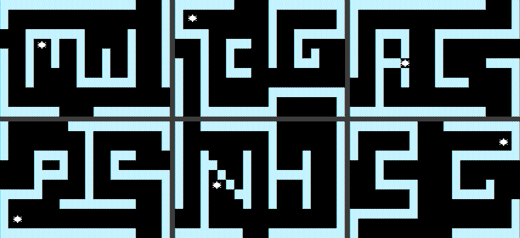

# Robot Odyssey I (Apple II) – Engine Notes

Runs on a 128K Apple IIe but uses only the 64K main RAM (aux is untouched),
including the language card. Graphics: hi‑res, double buffered (pages 1 and
2, flipped every tick by $AEED). Input: keyboard, joystick/paddles
($C061‑$C065, $C070), an Apple mouse card – see "Input". Sound: speaker
$C030.

## Memory map while playing

| Range | Contents |
|---|---|
| $0000‑$03FF | zero page, stack, $02D0‑$02D2 menu/level state, $03F2 reset vector |
| $0800‑$1FFF | **level code** (from $0803; main loop at $0841 in Level 1) and engine piece $1A50 |
| $2000‑$3FFF | hi‑res page 1 |
| $4000‑$5FFF | hi‑res page 2 (the loader/menu runs here between worlds) |
| $6000‑$94FF | **the world** – see WorldFormat.md |
| $9500‑$B7D6 | engine main: font, colour tables, drawing, text, objects |
| $B8E0‑$BFFF | engine piece |
| $C000‑$C0FF | I/O |
| $D000‑$DFFF | language card bank 2: engine code; bank 1: data (saved with the game) |
| $E000‑$EFFF | language card RAM: data (saved with the game) |
| $F000‑$FFFF | language card: engine code |

The level code differs per world. Its start‑up ($0816) sets engine vectors
(e.g. the draw routine at $AEEB) and ends with `LDA #0 / STA $9C51` right
before the main loop. Leaving a level goes through a handler
(`LDA #2 / STA $02D0 / STY $02D1 / … / JMP ($03F2)`) back to the loader.

## The tick (Level 1 main loop, $0841‑$091C)

One loop iteration is one game tick. In order (names from
`Data/RobotOdyssey.sym`; `_Q` = guess):

```
$A90C READ_INPUT          $0963 L1_KEY_COMMANDS      $DFA3 PLAYER_WALK_SPRITE
$BEBC GRAB_BUTTON         $1A50 KEY_T_HANDLER        $FE18 KEEP_MOVE
$1AB0 / $A5CD GRAB_AND_CARRY (if $8DAA = 0)          $0920 L1_HELD_CHANGED_Q
$9C53 MOVE_LINKED_OBJECTS $BED6 / $BDE1 TAKE_TOOL    $FE25 (if $8ED8 = $FF)
$DE95 / $DF81 CRYSTALS_Q  $0CA8 / $918B / $10F8 level specific
$D000 ROBOTS_RESET_Q      (if $8DAB = 5 – which it is on every tick of normal play:
                           $D832 thrusters, $DA90, $DE10, $F0CC wires, $F04B gates,
                           $F56B chips)
$F5A9  $1740 (level)      $DD59 PLAYER_IN_ROBOT
--- draw on the hidden page ---
$9D03 DRAW_ROOM_TILES     $A2A2 DRAW_ROOM_TEXTS      $1305 L1_SENTRIES (level)
$9D18 DRAW_ROOM_OBJECTS   $101A (level)  $D2BC DRAW_ROBOTS  $D72B DRAW_ROBOT_INTERIOR
$187C $0C06 $8F69 $0F93 (level)  $DDD0  $1E3B
$F7BE SOLDER_WIRE_Q / $F5C2 SOLDER_TOUCH_Q (pen in hand, CopyProtection.md)
$FC62 DRAW_WIRES  $F44D SENSORS_Q  $DA44
$A6AD (if $8DAA = 0 and $8E95 = $FF)   $AEED FLIP_PAGE
$9F3C PLAY_SOUNDS with the player's room swapped in (Sound.md)
```

The circuit is evaluated once per tick: wires copy the colour (signal) of
their source ($F0CC), gates are evaluated from a type table at $8CB7
($F04B), chips at $F56B: it runs the program of each of the 8 chips (chip
*n* at $D000 + $400*n*, program from +8; chips 0‑3 in language card bank 1)
up to opcode 7, so an empty chip must hold `07 FF FF FF` – the loader's job
(DiskLayout.md); with zeros there a tick never ends.

REMOTE_SWITCH $8DAB mirrors the player's colour (object 0, $6200): 5
normally, 7 (white) after the remote control's toggle ($BEF4); the robot
and circuit block runs only at 5. Both saved games on the sample storage
disk are at 7.

## Input

**Devices.** At start‑up every world calls DETECT_JOYSTICK ($AC24, from
$0819): if paddle 0's timer runs out after the $C070 strobe (it reads $C064
up to 1280 times, every 11 cycles), INPUT_DEVICE ($9C3E) = 1 (joystick);
else if a slot holds an Apple mouse card ($Cn0C = $20, $CnFB = $D6, from
slot 7 down through SLOT_POINTER $1B), 2; else 0 (keyboard). The keyboard
is always read, and in keyboard mode the paddles are too: the first change
of the paddle values switches to the joystick, a key back to the keyboard.
The mouse is set up and read through the card's firmware: CALL_MOUSE
($ACD6) calls the routine at offset ($Cn00+Y) with X = $Cn, Y = n × 16
(MOUSE_SLOT $A9D2, MOUSE_SLOT_16 $A9D3), patching the JMP at $ACE6;
DETECT_JOYSTICK turns it on, clamps it and puts it at (0, 0) (HOME_MOUSE
$ACC9; CLEAR_MOUSE_POSITION $AC12 clears the position's screen holes).
Its set-up of the card (SET_UP_MOUSE, $AC76‑$ACC8, not in the native):
MOUSE_SLOT and MOUSE_SLOT_16 from SLOT_POINTER's page, the JMP's page,
SETMOUSE 1 (on, no interrupts), CLEARMOUSE, CLAMPMOUSE up and down
$00C4–$003C and across $00E4–$001C (bounds in slot 0's holes $0478/$04F8,
high bytes $0578/$05F8 left 0: low above high, meant as −60…60 and
−28…28), HOME_MOUSE. Nothing but this code and CALL_MOUSE uses $1B/$1C,
and the text page with the holes is empty in every world. The viewer
plugs such a card in while the Mac's mouse is the game's (`AppleMouse`,
Frontends.md "Input").

**The mouse mode** (READ_DEVICE at $A9D4, INPUT_DEVICE 2): a key typed goes
first (KEY_AS_STICK, MOVE_BY_KEY; with a move or a button from it READ_DEVICE
returns, and READ_INPUT moves the player as in keyboard mode). Else READMOUSE
($Cn14 via CALL_MOUSE), READ_MOUSE ($ABDE): MOVE_DX = the X hole's low byte,
MOVE_DY = minus the Y hole's (Y grows down), each halved with its sign
(HALVE_MOUSE_MOVE $ACE9; not on a IIc, $FBC0 = 0 – language‑card RAM in the
worlds, never 0), BUTTON_A = 1 when the status hole has bit 7 or 6 (down now,
or at the last read); then LIMIT_MOVE with X = 7, Y = 15 (at $A9FB),
STOP_AT_WALLS unless WALLS_ON is 0, KEEP_ON_SCREEN, MOVE_OBJECT,
CLEAR_MOUSE_POSITION and POSMOUSE ($Cn16): the mouse back at (0, 0), what
moved past the limit lost. MOUSE_MOVED ($A909) = 1 tells READ_INPUT the move
is made. The native READ_INPUT declines in this mode (the original runs).

**READ_INPUT ($A90C)**, the first call of every world's main loop (Level 1
skips it while SENTRY_HELD is 0: a sentry holds the player):

1. READ_KEY ($AA25): one key per tick from $C000 (strobe cleared), lower‑case
   letters made capitals (AND CASE_MASK $9C21 = $DF) → LAST_KEY ($9C3D), 0 if
   none.
2. READ_JOYSTICK ($AACB), keyboard mode included: strobe $C070, then count
   rounds of a 24‑cycle loop while the timers run, at most 127 (paddle 0
   read 14 cycles after the strobe, paddle 1 at 23; once one has run out the
   loop keeps timing the other). The counts are doubled: PADDLE_X/Y
   ($AAC9/$AACA), STICK_X ($9C39) and STICK_Y ($9C3A, upside down). Buttons:
   button 1 alone → BUTTON_A ($9C3B), button 0 alone → BUTTON_B ($9C3C), both
   → neither. The counts run 0‑127 and the tables below take the centre at
   64 ($80), so the game wants a timer of about 3,060 cycles all the way
   (a PREAD of about 278). `InputDevices` gives 3072 cycles at position
   255 (12 a step): 128 is the centre, 0 and 255 the full moves. With a
   PREAD's 11 cycles a step (AppleWin: 2816 at 255) the counts reach only
   117, table entry 14: right 4 instead of 7, down 8 instead of 15.
3. Keyboard: KEY_AS_STICK ($AA40) centres the stick ($80/$80) and looks the
   key up in MOVE_KEYS ($9C13, ten keys each world copies there at start‑up;
   Level 1 from $080B): up, down, left, right, button A, button B, then
   slowly up, down, left, right. A match sets the stick to an extreme ($00,
   $FF) or near the centre ($3F, $C0), or a button, and uses the key up
   (LAST_KEY = 0). A key that is not a movement key stays in LAST_KEY for the
   world's own code.

   | Key (all worlds) | Stick | Move |
   |---|---|---|
   | I / M | y $FF / $00 | 16 up / down |
   | J / K | x $00 / $FF | 7 left / right |
   | Ctrl‑I / Ctrl‑M | y $C0 / $3F | 1 up / down |
   | Ctrl‑J / Ctrl‑K | x $3F / $C0 | 1 left / right |
   | space | button B | |
   | (button A: $01, never typed) | | |

4. The move: MOVE_BY_KEY ($AB54) or MOVE_BY_STICK ($ABA1) look up the stick's
   top four bits: MOVE_DX ($9C22) from $AB71 (keys: −7 −7 −1 −1 0… 1 1 7 7) or
   $ABBE (joystick: −7 −4 −2 −1 −1 −1 0 0 0 0 1 1 1 2 4 7), MOVE_DY ($9C23)
   from $AB81 (±16, ±1) or $ABCE (−15 −8 −4 −1 … 1 4 8 15). A held key
   moves once per tick, since the Apple repeats keys faster than the 4‑7
   ticks per second. So the joystick moves by how far it is pushed: within
   a quarter of the way out not at all (entries 6‑9), up to five eighths
   1 step, as Ctrl‑I J K M (3‑5, 10‑12), then 2 and 4 across (4 and 8 up
   or down), the last eighth 7 across (15).
5. LIMIT_MOVE ($ACF8, X = Y = $FF: no limit), then for the player (CURRENT_OBJECT
   = 0): STOP_AT_WALLS ($AD40) unless WALLS_ON ($9C30) is 0 (the easter egg
   below), KEEP_ON_SCREEN ($A934), MOVE_OBJECT ($9DB3).

Right after it the levels call PLAYER_WALK_SPRITE ($DFA3; v1.0 $DFA4): the
larger part of the move picks two frames (up 0/1, down 2/3, right 4/5,
left 6/7, from PLAYER_SPRITES $BF30) and each tick toggles the step
(WALK_FRAME $8ED7) into sprite 0; GRAB_BUTTON ($BEBC): GRAB_STATE ($8E3E) 0
without a button (or both), 1 on a new press, unchanged while held (the grab
code advances it); KEEP_MOVE ($FE18): the move to $8E88/$8E89. Then the
world's own key commands read LAST_KEY (Level 1, $0963: `?` and `/` a hint,
Esc "quit?", `L` with some objects held, …). A message waits for a key inside
the tick ($0A77 polls $C000). Leaving a world goes through its only
`JMP ($03F2)` to the loader, with the request in $02D0 (1 the menu, 2 the next
level, 4 save the game, 5 …) and a level in $02D1.

**Object motion** (engine main, used by the player's input, the robots and
the worlds' code). Positions: x 0‑$85 (7 per tile), y 0‑$B0 from the bottom
(16 per tile), 20 × 12 tiles; an object is a 7 × 16 box.

* MOVE_OBJECT ($9DB3; MOVE_OBJECT_XY $9DB9 with X = room, Y = object): adds
  the move; x of $D8 and more has left by the left edge (+$86, ROOM_LEFT),
  $86 and more by the right one (−$86, ROOM_RIGHT); y likewise with $B1
  (ROOM_DOWN, ROOM_UP). The room it ends in → DESTINATION_ROOM ($9C2E), then
  SET_OBJECT_ROOM ($9E07): out of the old room's object list, into the new
  one's, which stays sorted by object number.
* KEEP_ON_SCREEN ($A934): a move past the left/right edge goes exactly to it
  ($FF/$86, SCREEN_EDGES_X $A979) and loses its vertical part; past the
  bottom/top ($FF/$B1) its horizontal part.
* STOP_AT_WALLS ($AD40): TEST_MOVE ($AE69) checks the box's four corners
  after the move: bit 0 a wall (WALL_AT $B40B on the room's bitmap,
  ROOM_WALLS_POINTER $9D56: 30 bytes, three bands of four rows from the top,
  a byte = two tile columns of 4 bits), bit 1 x ≥ $8C, bit 2 y ≥ $C0. On a
  wall only, it keeps the longer part of the move and stops the shorter one
  at the edge of the tile the object is in (STOP_AT_TILE_ROW $AE2A /
  COLUMN $ADD5), then the other way round, else stops both. Bit 1 clears the
  vertical move, bit 2 the horizontal one.
* LIMIT_MOVE ($ACF8): at most X across, Y up or down (the worlds' code uses
  it for other objects).
* GRAB_AND_CARRY ($A5CD; the levels call it only with no tool in hand): a
  button pressed while holding something drops it (HELD_OBJECT $9C26 and
  GRABBED_OBJECT $9C27 = $FF); with nothing held it takes the object
  touched (TOUCHED_OBJECT $A8FC): the first object of the player's room
  whose pixels touch the player's (OBJECTS_TOUCH $A835) and that the player
  may take – TOUCH_TAKEABLE ($A7D6): OBJ_FLAGS ($6900) not $FF, which rules
  out the pins, the tools and the tip; with FLAG_9C51 = 1 any object
  (TOUCH_ANY $A7C7). GRABBED_OBJECT is that one, HELD_OBJECT the end of its
  OBJ_LINK chain (a robot's body, a gate's base), and HELD_DX/DY
  ($A5C9/$A5CA) its place from the player. Every tick, after the world's
  hook (GRAB_HOOK, the JSR at $A66D; NOPs on the disk, the start‑up code
  puts it in), FOLLOW_AT ($9C7C) moves HELD_OBJECT to the player plus that
  offset, across room edges as MOVE_OBJECT_XY does.
* Wires don't follow their pins by themselves: a wire's ends are
  coordinates (WorldFormat.md). The levels' hook is CARRY_WIRES ($B8E6):
  for HELD_OBJECT and the objects that follow it (higher numbers only), the
  wire ends at each pin (PIN_TYPES $8397 by sprite, the pin at PIN_DX/DY
  $83D7/$8417 from the object; gates and chips by their own tables) move by
  KEPT_DX/DY ($8E88, the player's move this tick, KEEP_MOVE), as FOLLOW_AT
  is about to move the object. Carried onto the room's edge (x plus the
  move 0 or $84 on, y 0 or $AF on) or out of CARRY_ROOM ($8E55, the room it
  was taken in), a pin's wires are cut (UNSOLDER $F5D3, the solder sound). The kit and
  the lab have the same in their $F000 pieces: CARRY_WIRES $F367/$F0A0,
  PIN_TYPES $1D74/$1554, KEPT_DX/DY $1BE8/$13A9, CARRY_ROOM $1B58/$1316.
* MOVE_LINKED_OBJECTS ($9C53): objects 0‑$FE in order, each one that follows
  another (OBJ_LINK) goes to that one's place plus OBJ_DX/DY (FOLLOW_LINK
  $9C88). One that follows a higher object takes where that one was before
  its move: it lags a tick, and a part of what the player carries can be in
  the room left a tick after the player (more ticks down a longer chain), or
  stay there until the player gets far enough. The viewer draws the rooms
  those are in again every tick (`World.carried`), each preview going on
  from the draw state the room's previous one left (`GameLoop.preview`), so
  that robots there animate.
* Tools (levels; TAKE_TOOL $BDE1, with nothing held): the keys C, S, R
  (TOOL_KEYS $82FA), or the button on a tool lying about (TOUCHED_TOOL
  $BE76), take the player's own look, the soldering pen ($FD) or the remote
  control ($FC) (TOOL_OBJECTS $82F7 → TOOL_MODE $8DAA); the tool in hand
  puts it away. SWAP_WITH_PLAYER ($BEA3) swaps the sprite and colour of the
  player and the tool object, so the player *looks like* the tool and the
  tool object keeps the player's look until it is swapped back. Object $FE,
  linked to the player at (0,0) in every world, is the tool's tip: blank
  (sprite $1A) but with the pen, sprite $1D colour 6 (TOOL_TIP_SPRITES
  $8300, TOOL_TIP_COLOURS $82FD); the soldering code looks at what is
  under it (below). With the remote control in hand a new press of the button
  (REMOTE_CONTROL $BED6) toggles the player's colour and REMOTE_SWITCH
  ($8DAB) between 5 and 7: the robots and the circuits run only at 5.
* Soldering (levels; with the pen in hand, after the draw, CopyProtection.md):
  TIP_ON_PIN ($F86A) finds the pin the tip touches (TOUCH_ANY with
  TOUCH_FIRST = $FE; a sprite with a PIN_TYPES entry: 1 or 2 a single pin,
  $FD/$FE gates and $F0 chips with the pin found by where the tip is) and
  colours the tip orange (5) on a pin, else blue (6). SOLDER_WIRE ($F7BE)
  acts on a new press (GRAB_STATE 1): with no wire started, on a pin
  without a wire it starts one (SOLDER_PIN $8E40, its type $8E41, the start
  $8E46/$8E47, SOLDER_ROOM $8E48, the solder sound); with one started, on a
  pin of the other type (1 with 2) it makes the wire, on one of the same
  type nothing, anywhere else it cuts the wire being made, as does the
  player leaving SOLDER_ROOM. Each tick DRAW_SOLDER_WIRE ($FC2C) draws the
  wire being made in white, L‑shaped from the start to the tip + (2, 4).
  SOLDER_TOUCH ($F5C2), with no wire started: a new press on a pin with a
  wire cuts it (UNSOLDER, the pin white again). A pin counts as taken (no wire
  starts there) when it is a wire's target, a loose wire's, or on a chip
  (PIN_TAKEN $F78C; CHIP_PIN_OBJECTS $8C9E, 8 per chip, chips are
  objects $E7‑$EE). The kit
  and the lab: the same code in their pieces (SOLDER_WIRE $F652/$F59B,
  SOLDER_TOUCH $F1AF/$18B0 – the lab's in the worlds' code –, TIP_ON_PIN
  $F6F2/$F647, SOLDER_PIN $1B42/$1303); Robot Anatomy calls them but its
  main loop has no TAKE_TOOL, so no pen.

### Easter egg: walking through walls

A key hidden by the menu lets the player walk through walls in Robotropolis.

1. In the menu (“Press SPACE to choose — RETURN to load”) type **Ctrl‑A,
   Ctrl‑L, T** (a capital T; nothing shows). MENU_READ_DEVICES ($619B) sets
   WALLS_KEY ($03FF) to 1 on Ctrl‑A ($81, at $6209), adds 1 on Ctrl‑L ($8C,
   $6210), and on T ($D4, $6216) makes it $85, Ctrl‑E, if it is 2. So the
   three in this order, Ctrl‑L once.
2. Choose Robotropolis (a new game, or O for a saved one).
3. In a level, **Ctrl‑E** turns WALLS_ON ($9C30) off and on again: the key
   commands of levels 1‑5 (Level 1's KEY_COMMANDS $0963 at $0979, Level 2
   $0999, Level 3 $09A6, Level 4 $09AC, Level 5 $17CC) compare the key typed
   with WALLS_KEY and toggle bit 0.

With WALLS_ON 0 the player's move skips STOP_AT_WALLS (READ_INPUT at $A925,
READ_DEVICE at $AA07): walls no longer stop the player, the screen's edges
still do (KEEP_ON_SCREEN), and it walks into the room next door as always.
Nothing else reads WALLS_ON, so robots and the other objects still stop at
walls. Taking or putting down a tool (TAKE_TOOL: $BE54 and $BE72 as it sets
TOOL_MODE) sets WALLS_ON to 1: the walls are back until the
next Ctrl‑E.

The title clears WALLS_KEY ($6023), the menu without the title ($6003)
doesn't, and nothing else writes it (the loader, boot stage 2 and the
worlds' code only read it): the key lasts until the game reboots (Esc in the
menu, a cold start), across level changes, saving and restoring. It isn't
saved with a game. Before the code is typed WALLS_KEY is $00, which no key
gives (keys have bit 7 set).

The other worlds: **Robot Anatomy** turns WALLS_ON off and on with Ctrl‑E
without any code (its key commands at $0931 compare LAST_KEY with $85
itself); the Innovation Lab and its tutorial only set it with their tools
($17F2, $1810), as the kit engine does for Toolkit ($BE73, $BE91); none of
them has a key for it.

In the app: worlds started from the sidebar have WALLS_KEY $00, so go to the
menu with *Play* on (Esc Esc in a level), type the code there, then choose
Robotropolis. The app types Ctrl + letter as the control code.

### Level 1: the shuffled objects

Five objects lie elsewhere in every new game. L1_SHUFFLE_OBJECTS ($10F8,
called by the main loop after $918B) runs each tick until L1_SHUFFLED
($8F46, 0 on the disk) is set. While the player is in room $28 (the start)
or $02 (the three robots), it counts L1_SHUFFLE_TICKS3/6 ($8F47/$8F48, 0 on
the disk) on, modulo 3 and 6, and draws L1_SHUFFLE_PAIR ($8F49) =
RANDOM_BELOW_A 2 and L1_SHUFFLE_CRYSTAL ($8F4A) = RANDOM_BELOW_A 6. The
first tick the player is in any other room, it places them (SET_OBJECT_ROOM,
via L1_PLACE_OBJECT $11AF) and sets L1_SHUFFLED to 1:

| Object | Places | Chosen by |
|---|---|---|
| key $FA (sprite $38; “The key to success lies within.”) | the interior of robot $F0, $F2 or $F4 (rooms $09 $0A $0B, L1_SHUFFLE_KEY_ROOMS $11B9), at ($3C, $2A) | ticks mod 3 |
| energy crystal $F6, object $03 (sprite $37) | rooms $22 at ($47, $24) and $23 at ($43, $60), or the other way round (L1_SHUFFLE_PAIRS $11DC) | random |
| chip 1 $E7 | maze room $08 ($4A, $44), $0C ($79, $98), $07 ($20, $37), $06 ($52, $46), $17 ($5B, $75), $16 ($25, $98) | ticks mod 6 |
| black crystal $04 | maze room $08 ($1F, $6E), $0C ($0B, $9A), $07 ($2A, $50), $06 ($0B, $17), $17 ($1F, $4F), $16 ($7B, $96) | random |

The maze rooms come from L1_SHUFFLE_MAZE_ROOMS ($11BC), the spots from
$11C2/$11C8 (chip) and $11CE/$11D4 (crystal). The black crystal's six
spots, drawn in white (`Data/ro_shuffle.py`; top: rooms $08 $0C $07,
bottom: $06 $17 $16):



The level isn't shuffled when it starts, but when the player first leaves
the start rooms: *n* ticks in them put the key in room $09 + *n* mod 3 and
the chip at entry *n* mod 6 (*n* = 1 gives the disk's places, room $0A and
$0C); the random numbers are those of the last tick there, and every tick
advances the generator (robot 1's, Sparky's, dots alone by 32 steps, Robots.md), so the
crystal's room can't be foretold. The chip and the crystal may share a room. The black crystal's
place on the disk (room $07 at ($1F, $3D)) is none of the six, so a game
never shows it there. A saved game keeps L1_SHUFFLED, so restoring one
shuffles nothing. Checked on the emulator from the Level 1 save state
(L1_SHUFFLED 0, room $28): 0‑7 ticks there, then the player moved to room
$03, give the places of the table.

### Level 1: the Ampire Bot and the black crystal

Object $04 is a **black crystal**: the crystal sprite 57 (as the energy
crystals $11 and $F6) in colour 4, black, on the room's black floor (colour
4 too). The engine draws it like any object, but every pixel stays black, so
it can't be seen on the floor; the room view shows the same. Only over the
walls, or in the viewer's *Current Room* panel (colour 4 in grey), does it show. On the
disk it lies in room $07; a game puts it on one of six spots in the maze
(above), so finding it means trying them, grabbing in the dark. The hint for
it is on the *?* screen (room $01): “Black crystals foil Ampire Bots.”

The **Ampire Bot** is no object: Level 1's code keeps it in $8F4B‑$8F57
(L1_AMPIRE_STATE, _ROOM, _X, _Y, ...), moves it each tick (L1_AMPIRE_BOT $0CA8) and draws it in the
current room (L1_DRAW_AMPIRE_BOT $0F93, 4 frames from $1212/$1216, blue).
It waits in room $10 until the player or a target is there, comes down and
patrols $10 → $0F → $21 → $15 → $12 → $11 → $10. L1_FIND_AMPIRE_TARGET ($0F50)
tries L1_AMPIRE_TARGETS ($121A: $F6 $F0 $F2 $F4 $04) from the last, among the
objects in its room: the black crystal first, then the robots $F4, $F2, $F0
(battery not empty) and the energy crystal $F6 (not white). It goes for the
target, follows it into another room at once, and after 20 ticks on it
(sound 7) the target is drained: a robot loses 5 of its battery (floor 0),
the energy crystal turns white (used), and then it rests ≈200 ticks
(blinking orange, L1_AMPIRE_REST $8F51/$8F52), taking no target meanwhile.

Drained the black crystal, it turns green (L1_AMPIRE_COLOUR 1) and goes to
state 5, which L1_AMPIRE_BOT doesn't handle: it stays where it is for good and
drains nothing again. The crystal itself doesn't change. Bringing the black
crystal into the Ampire Bot's room is the way to get rid of it.

A quirk: the black crystal shares robot $F4's branch in L1_FIND_AMPIRE_TARGET
(the check is `$F6`, `$F0`, `$F2`, else robot 2's (Scanner's) battery $8E19), so the
Ampire Bot ignores it while robot $F4's battery is empty. Checked on the
emulator with the crystal moved into room $10: the bot takes it at once,
turns green after 20 ticks and stays; with $8E19 = 0 it never leaves state 0.

Leaving the sewer (L1_LEAVE_SEWER $0AC9) parks the black crystal in room $3F
as sprite 1, white, also when a robot holds it: the robot's grab state
($8DB1‑$8DB3) is cleared and an object in its interior turned white —
$E4 for $F4, $EF for $F2, and $EF again for $F0, where $D0 (the same
object in $F0's interior) looks meant.

## Chips

The chips use the same bytecode as the PC version's CHP files, so Micah
Dowty's disassembler (`Data/ro_chip_disasm.py`, ported to Python 3)
reads them unchanged; `Data/ro_chips.py` finds them on the program disks, in
save states and on storage disks (listing: `Data/Extracted/v1.1/chips.txt`).
v1.0 and v1.1 have the same chips.

A chip is 8 pin bytes (pins 1‑4, then 8‑5) followed by its program. Every
input is a byte *inside* the program holding its current value (0/1); every
output is a list of 16‑bit big‑endian offsets from the chip's start (to pin
bytes or to other parts' input bytes), ended by $FF:

| Opcode | Part | Operands |
|---|---|---|
| 01 / 02 / 03 | AND / OR / XOR | in0 in1, outputs |
| 04 | NOT | in, outputs |
| 05 | flip‑flop | in0 in1 state0 state1, outputs of half 0, outputs of half 1 |
| 06 | nested chip | a whole chip inline (its offsets relative to its own start) |
| 07 | end | lists *source, destinations…* (wires to and from pins), an empty list ends the chip |

The chip table at **$F008 + 8n** holds chip *n*'s pin directions in the same
order (0 unused, 1 in, 2 out) – the PC CSV files' PIN table. The saved‑game
header keeps it at +$00 (DiskLayout.md).

Chips on the disks (the loaders' set‑up):

* Level 1, kept by levels 2‑5: chip 0 ($D000, 426 bytes; pins 1‑2 in, 3‑8
  out): 2 flip‑flops, 2 ANDs, a NOT and 5 nested chips of one flip‑flop each.
  Chip 1 ($D400, 386 bytes; pins 2, 4, 6, 8 in, 1, 3, 5, 7 out): ORs, ANDs, a NOT
  and a nested chip with 4 flip‑flops.
* Innovation Lab Tutorial: chip 0 ($D000, 17 bytes, pin 1 out) is a NOT
  whose output feeds its own input and pin 1 (a clock); chip 2 ($D800) is
  Level 1's chip 1.

The disassembler's notes on evaluation (PC version: parts run in program
order, outputs to the current chip's pins or nodes propagate at once, others
are queued until just before the nodes; flip‑flops in chips don't toggle with
both inputs high; one extra tick of delay across a nested chip's pins) are
still to be checked against $F56B.

## Timing

The engine never waits for the vertical blank: a tick takes as long as its
work, mostly redrawing the whole room. Measured with `Data/ro_timing.py`
(Level 1 save state on the emulator, no input, 1.0205 MHz):

| Room | Objects | Cycles/tick | Ticks/s |
|---|---|---|---|
| $04, $14, $1F (maze) | 2‑4 | 150‑156 K | 6.5‑6.8 |
| $2C | 7 | 165 K | 6.2 |
| $01 (text) | 2 | 186 K | 5.5 |
| $28 (welcome, much text) | 2 | 200 K | 5.1 |
| $02 (three robots) | 8 | 229 K | 4.5 |
| $09 / $0A (robot interiors) | 20‑28 | 254‑270 K | 3.8‑4.0 |

So the original runs at roughly **4‑7 ticks per second**, varying by room.
(Measured without joystick reads; the paddle read loops add up to ~3 ms per
read on real hardware. Worth confirming in Mariani with a breakpoint on
L1_MAIN_LOOP and the cycle counter.) `GameLoop` on the worlds built from the
disks agrees: Level 1's room $28 takes 200‑208 K cycles per tick, 5.0
ticks/s.

What matters for circuits is **the tick**: every robot, sensor, wire, gate
and chip is updated exactly once per tick in a fixed order, and nothing in
the simulation looks at wall‑clock time. A port that keeps the per‑tick
update order bit‑exact keeps every circuit working, whatever the tick rate.
The wall‑clock rate is a separate, user‑visible choice:

* **Authentic** – compute each tick's cycle cost (or run the original code)
  and pace ticks at 1.0205 MHz, reproducing the room‑dependent speed. The
  viewer does this (below: each tick shown as it starts).
* **Fixed** – a constant rate (e.g. 5 or 6 ticks/s), smoother but not
  identical in feel.
* **Fast** – for testing circuits.

**Latency and smoothness in the viewer.** On the Apple a key waits for the
next tick's READ_INPUT, and the tick then draws the back page for its whole
length before FLIP_PAGE shows it: up to two ticks (about 0.4 s) from key to
screen, the picture changing 4‑7 times a second. The viewer keeps the
ticks' pace but shows them earlier and in between (`GameLoop`):

* **A tick at once.** `run(until:finishingTick:)` runs to the clock, then
  the tick under way to its end, so the page is on screen as the tick
  starts; the next tick starts when the clock reaches its first cycle. It
  stops early where the game waits: for a key (`Machine.waitsForKey`, the
  keyboard read again and again within 256 cycles without a key, as the
  message boxes' $0A77 does), 500,000 cycles past the clock (a sound), or
  10,000 cycles after the tick's flip (a world flipping pages itself); from
  there the tick runs by the clock as before. PLAY_SOUNDS as 6502 code
  (its native switched off) runs on past the flip, as the native takes a
  sound's cycles at once: otherwise only the sound's first clicks came with
  the page and the rest once the clock had caught up, about 150 ms later
  (Sound.md, *The stream*).
* **In‑between frames** (*Smooth*). Each flip keeps the machine where its
  draw phase started. Between two pages of the same room, `inBetween(at:)`
  takes the newer one's draw start, sets what moved since the page before
  part of the way back – object x/y of the objects in the room, the wires'
  and loose wires' ends, each where it moved at most 8 across and 16 up or
  down (the player's step) – and runs the draw phase on that copy. Redrawing
  from a page's draw start gives the page byte for byte (all nine worlds,
  walking), so an in‑between frame is the game's own drawing with only the
  positions moved; robots' parts follow their body's x/y. The glide runs
  over the tick, from the tick's start to the next's, so a page is reached
  when the Apple would have shown it. It costs one draw phase per changed
  frame: about 0.7 ms in a Release build, 6 ms in a Debug one.
* **Held keys.** A movement key held down (`InputDevices.held`, one of
  MOVE_KEYS' movement keys) is typed again as each tick starts, where
  READ_INPUT reads it, until it is let go: one step per tick from the first,
  without the Mac's repeat delay, and never typed into a message's wait.
* **Game controller** (`GameControllers`, read every display frame): the
  joystick, its left stick or d‑pad as the paddles (the round gate
  stretched to the Apple's square one, 0.2 around the centre the centre)
  and A/X, B/Y as buttons 0 and 1. A button press reads as down until a
  tick has started with it (`InputDevices.set(button:down:)`), so a press
  shorter than a tick still reaches READ_INPUT, once. Without *Play* the
  joystick stays plugged in, centred.

## The draw phase

Every world's main loop draws between `LDA $6300 / STA $9C2D / JSR …` (the
current room is the player's room; the JSR is $DD59 PLAYER_IN_ROBOT in the
levels, $DC16 in Anatomy/Toolkit, $DBAF in the lab worlds) and `JSR $AEED`
(FLIP_PAGE). In between come the engine's drawing routines and the world's
own (Level 1: $1305, $101A, $187C, $0C06, $8F69, $0F93; Robot Anatomy's
$09CD; Level 5's code rooms via $7294 …). `DrawPhase` (Machine.swift) finds
these bounds and the main loop's first instruction in any world.

## The hybrid engine (Swift)

The game runs as the original 6502 code on `CPU6502`, inside `Machine`.
`CPU6502` is the `MOS6502` package (github.com/mdaskalov/MOS6502, its README): the
NMOS 6502 of the Apple //e as AppleWin/Mariani runs it, all 256 opcodes, its
cycle counts, every read or write on the cycle the 6502 makes it (a click is
the cycle `LDA SPEAKER` reads $C030, its last); checked against AppleWin's
own code (the package's `Data/cpu_check.sh`). A BRK stops with an error (`stopsAtBRK`):
there is no ROM behind its vector.

* The machine is Apple2Kit's `Apple2` (github.com/mdaskalov/Apple2Kit), a
  //e without ROMs (`Machine.apple`): 64K main RAM plus the language card's
  RAM, always read and written; a switch via $C080‑$C08F picks its $D000
  bank (bank 1: engine data, chips), which lies in `cpu.mem` at $D000 with
  $E000‑$FFFF (Apple2Kit maps the card's RAM into flat memory, so natives
  read it in place and the CPU runs the engine at full speed). The chips ($F56B) and sensors ($F44D) use
  bank 1 every tick. Worlds built from the disks get bank 1 (and chips 4‑7 at
  $E000‑$EFFF, the chip table at $F008) from the loader's set‑up after
  loading the world (`ChipSetup`, DiskLayout.md): Level 1, and with it levels
  2‑5, gets two chips (167 → $D000, 165 → $D400 – the Level 1 save state
  holds exactly these), the lab tutorial two others, the lab only empty
  chips; saved games bring their own.
* soft switches: `Apple2`'s – display page $C054/$C055, speaker $C030, the
  language card, the slots (the mouse card, `AppleMouse`) – and the game's
  own, through its `ioHook` (`Machine.io`): keyboard $C000/$C010 and the
  input devices (`InputDevices`, which the natives read too): buttons $C061/$C062, paddle
  timers $C064/$C065 started by $C070 and timed by the CPU's cycle counter
  (3072 cycles at position 255, the range READ_JOYSTICK measures; "Input").
  Without a joystick (the default) the timers never run out, so the engine
  finds none and plays by keyboard; a joystick can be plugged in at any
  time (the viewer's game controller). Timers that run out at once read as
  a joystick held up‑left, and timers that never do (a joystick unplugged)
  as one held down‑right: in joystick mode the player walks off.
* **native routines**: a Swift method of `Engine` registered at an engine
  entry point runs when the 6502 code reaches it – by JSR, JMP or falling
  through (CPU traps) – and returns like RTS. It works on the same memory
  (`m`, a `RAM`: the CPU's own bytes with every symbol of `GameSymbols` by
  name), the registers (`r`) and the input devices, takes its parameters
  where the 6502 code does and must leave memory **byte for byte** as the
  original leaves it, temporaries included, and A, X, Y and the flags where
  other code may use them (routines that the worlds' code calls). It may
  decline a case it doesn't handle (READ_INPUT with a mouse,
  DETECT_JOYSTICK finding a mouse card) and the original code runs. Each native names the routine it replaces and the
  ones it reproduces besides (`Native.all`); every one of them has its code
  ranges and their MD5 per engine build and version in `GameSymbols`. The
  loader (`WorldBuilder`) checks them when it loads a world (`CodeCheck`),
  and `GameScreen` installs only the natives whose routines all match: a
  modified routine, or an unknown version, runs as the original code
  (Symbols.md).

So level and room code always runs as the original code, and engine
routines become Swift one at a time. Ported so far (methods of `Engine`):

| Routines | File | Worlds |
|---|---|---|
| DRAW_ROBOTS $D2BC, DRAW_ROBOT_INTERIOR $D72B (kit/lab $D2AB/$D674), with DRAW_SPRITE(_COLOUR), PLOT, the lines and DRAW_BOX (Robots.md) | `RobotDrawing`, `EngineGraphics` | all |
| READ_INPUT $A90C, DETECT_JOYSTICK $AC24 (registers exact) | `PlayerInput` | all |
| MOVE_OBJECT $9DB3, MOVE_OBJECT_XY $9DB9, SET_OBJECT_ROOM $9E07, ROOM_WALLS_POINTER $9D56, WALL_AT $B40B, STOP_AT_WALLS $AD40, KEEP_ON_SCREEN $A934, LIMIT_MOVE $ACF8 (registers exact) | `ObjectMotion` | all |
| PLAYER_WALK_SPRITE $DFA3 (v1.0 $DFA4), GRAB_BUTTON $BEBC, KEEP_MOVE $FE18 | `PlayerInput` | levels |
| PLAY_SOUNDS $9F3C with PLAY_TONE $9EBB, PLAY_NOISE $9E7A (registers, cycles and clicks exact; Sound.md) | `Speaker` | all |

A native routine takes no CPU cycles unless it reports them
(`Engine.elapsed`, added to the CPU's when it returns). PLAY_SOUNDS does, to
the cycle, as a sound stops the game for up to 2 s; the others don't, so a
tick with natives is shorter than the original's (READ_INPUT's paddle loop
alone is about 3,000 cycles): the tick's work is identical, but the
*Authentic* pacing runs faster where natives run. That is what they are for
(decided 2026‑11‑03): the original slows down with many objects in a room;
only what a tick does must stay the original's.

`GameScreen` uses this for the viewer: it runs the world's start‑up code
($0803 up to the main loop) once, then for any room sets $9C2D and runs the
draw phase, so rooms look exactly as in the game, including what the world's
own code draws. A world built from the disks starts with the random generator
at $4E/$4F = 0, which it never leaves; `GameScreen` seeds it (Robots.md).

`GameLoop` runs the main loop from there as in the game, with the input
devices (`devices`; the viewer's *Play* types keys): it is run by CPU cycles and the page on screen ($C054/$C055) is what the
Apple shows, so each tick takes as long as its work. To watch any room, the
selected room replaces the player's in `CURRENT_ROOM` when the loop arrives at
the draw phase, and the loop's own value goes back before the page flip, so
the rest of the tick (including the `$6300 ↔ CURRENT_ROOM` swap around $9F3C)
sees what the game would. Watching the player's room changes nothing
(checked tick by tick on every world); elsewhere only what the draw phase
writes differs. A room change shows the room at once, drawn on a copy of the
machine at the start of the tick (`preview`). All eleven worlds (nine from
the v1.1 disks, two saved games) run 100 ticks with the player standing
still; v1.0 needs its own file lengths (`GameCatalog.lengthsV10`: its
level engine is one byte longer, and that byte is code). Where the world
hands back to the loader (`exit`, its `JMP ($03F2)`: the menu, the next
level, saving…) the loader runs as 6502 code until it starts a world, whose
main loop the loop runs on (Loader.md); without a drive the loop stops there.

## Porting strategy

1. **Reference engine** – the original code on `CPU6502` in `Machine`, with
   the language‑card banking and the input devices (done: whole ticks in
   `GameLoop`). This gives golden traces: the world memory after every tick
   for a given input sequence.
2. **Native engine** – port the engine routine by routine as native routines
   of the hybrid engine (above): input, player movement, grabbing, linked
   objects, robots (thrusters, bumpers, antennas, grabbers, sensors,
   batteries), wires, gates, chips, room transitions. Done: the robot
   drawing, the input and the object motion. Each starts with its symbols:
   its variables, tables and code (with fingerprints) in `GameSymbols`
   ("Mapping a new routine" in Symbols.md).
3. **Lock‑step tests** – `Data/native_check.sh` compares every native routine
   with the original, per call on random states, per drawn frame and over
   whole ticks (each world's main loop, 40 ticks: all memory, bank 1 and the
   page on screen after every tick), and 300 more ticks with the same input
   fed to both before every tick (keys held for a while, then a joystick
   and its buttons); any difference points to the routine to fix.
4. **Level and room code** ($0803 code, $8EF0 segments, code rooms) stays
   original 6502 code: it is world‑specific puzzle logic that pokes the same
   tables, and running it as is cannot break it.
